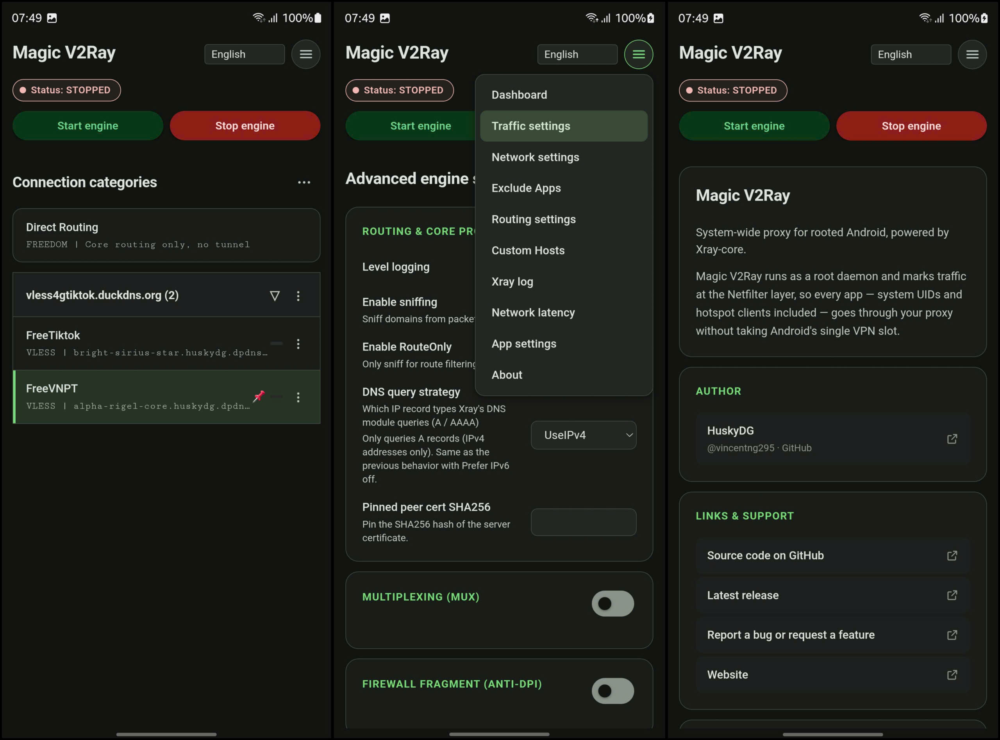

# Magic V2Ray

[Xem phiên bản Tiếng Việt](./README_vi.md)

 

A powerful, modern internet proxy manager for Android devices (supporting both Rooted and Non-Rooted environments). It routes system and application traffic through high-performance proxy cores to secure your connection, bypass network restrictions, and share your connection with other devices.

---

## What is Magic V2Ray?

**Magic V2Ray** is an advanced network client for Android. Built as a standalone Android app, it packages management tools and proxy cores natively to create a seamless network connection across your device.

Starting with **v2.0**, Magic V2Ray introduces a **Non-Root Mode** powered by Android's `VpnService`, allowing non-rooted users to run the proxy engine smoothly. Rooted users continue to enjoy kernel-level daemon routing, persistent background processing, and low-level packet marking.

It features a clean Web UI to organize proxy configurations, manage subscriptions, and monitor your network with ease.

---

## Key Highlights & Operation Modes

### 1. Root Mode (Daemon Engine)
Designed for maximum stability and advanced network routing on rooted devices (Magisk, KernelSU, APatch):
- **Immortal Connection:** Operates as a root-level system daemon. The OS Low Memory Killer (LMK) will not kill the process under heavy memory pressure.
- **Deep Routing Coverage:** Intercepts traffic at the Netfilter layer, enabling transparent proxying for system UIDs that standard VPNs cannot reach.
- **No System VPN Slot Consumed:** Works without taking up the standard Android VPN slot—no permanent VPN key icon in the status bar, and no conflicts with per-app VPNs.
- **Native Hotspot / Tethering:** Intercepts traffic at `PREROUTING` to route tethered devices (Wi-Fi Hotspot, USB Tethering) through the proxy tunnel automatically.
- **Dynamic Reconnects:** Listens directly to kernel network events (`ip monitor`) for instant Wi-Fi ↔ Cellular handovers.

### 2. Non-Root Mode (VpnService)
Starting with **v2.0**, devices without root access can run Magic V2Ray seamlessly using Android's native `VpnService` engine:
- Safe, standard user-space proxy routing.
- No root or custom kernel modules required.

---

## Additional Features

- **Quick Settings Tile:** Toggle the proxy engine directly from your notification shade. Long-pressing the tile opens the app.
- **Live Module Updates:** Fully supports live updates for version 176 and newer—upgrade the service on the fly without rebooting your device.
- **Category Organization:** Group your proxy servers into custom folders/categories.
- **Smart Subscription Import:** Easily paste subscription URLs, raw configurations, or mixed text codes.
- **One-Click Auto-Reload:** Keep your subscriptions up-to-date with a single tap.
- **Hotspot Sharing without root:** in Non-Root mode, Shizuku can share the proxy with hotspot / USB clients (Android 13+).
- **Hotspot Sharing:** Share your proxied connection with laptops, consoles, or other phones via IPv4/IPv6 Wi-Fi Hotspot.

---

## Installation & Usage

Magic V2Ray is distributed as a standalone Android application (`.apk`), which also doubles as a flashable root module zip.

### Non-Root Users
1. Download and install `magic_v2ray-*-arm64-v8a.apk` (or `-x86_64.apk`).
2. Open the app, select **Non-Root (VpnService) Mode**, grant the VPN permission, and start the connection.

### Root Users (Magisk / KernelSU / APatch)
**Option A: Install via Root Manager (Module + App)**
1. Rename `magic_v2ray-*.apk` to `magic_v2ray-*.zip`.
2. Flash it in Magisk / KernelSU / APatch (Modules → Install from storage). It installs the background module and runs `pm install` for the app interface.
3. Reboot, or open the app directly.

**Option B: Standard APK Installation**
1. Install `magic_v2ray-*-arm64-v8a.apk` and open it.
2. Grant Root permissions. The app automatically checks and sets up the root daemon engine in `/data/adb/modules/magic_v2ray` (user settings are preserved in `/data/adb/magic_v2ray`).

*Note: The module's **Action** button (Magisk 27+ / KernelSU / APatch) launches the app directly, installing `app.apk` automatically if it is not present.*

---

## Building from Source

```sh
./build.sh          # Outputs APKs (arm64-v8a, x86_64, universal) -> dist/
                    # (Each APK can also be renamed to .zip to serve as a module installer)

```

**Requirements:**

* JDK 17+
* Gradle 8.7+ (8.9 recommended)
* Android SDK (`ANDROID_HOME`, target platform `android-35`)
* Android NDK (for native helpers)

The Web UI assets are located at `app/src/main/assets/webroot`. The app exposes a `window.ksu`-compatible bridge (`exec`, `listPackages`, `getPackagesInfo`).

---

## Acknowledgments & Credits

* **[Xray-core](https://github.com/XTLS/Xray-core):** The underlying engine handling next-generation proxy protocols.
* **[curl-android](https://github.com/vvb2060/curl-android):** Pre-built `curl` command-line tool and `libcurl` static library prefab.

---

## License

By using this project, you agree to the terms and conditions set forth in the license. For more details, please refer to the [LICENSE](LICENSE) file in this repository.

Essentially, you are free to use, modify, and distribute this software, provided that you include the same license and source code availability in your own project. Moreover, using its source code or replicating its features within closed-source software may constitute a violation of the license terms.