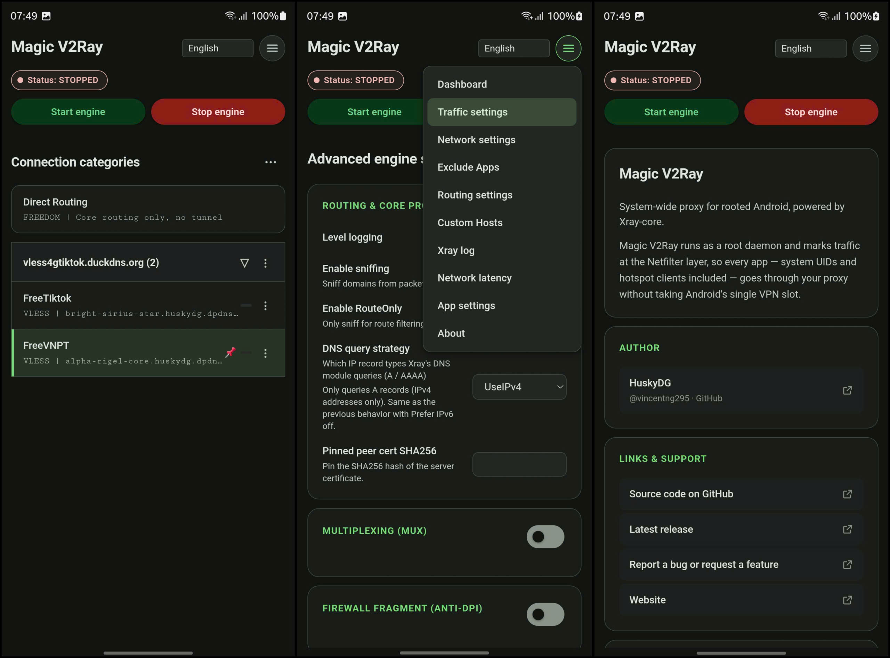

# Magic V2Ray

[View English version](./README.md)



Một ứng dụng quản lý proxy Internet mạnh mẽ và hiện đại cho Android (hỗ trợ cả thiết bị **Root** và **Chưa Root / Non-Root**). Dự án giúp bạn định tuyến toàn bộ lưu lượng mạng của hệ thống và ứng dụng qua proxy để bảo mật kết nối, vượt tường lửa và chia sẻ mạng cho các thiết bị khác.

---

## Magic V2Ray là gì?

**Magic V2Ray** là giải pháp mạng nâng cao dành cho Android. Được thiết kế lại thành một ứng dụng Android độc lập, ứng dụng đóng gói sẵn toàn bộ các binary và tài nguyên quản lý proxy để tạo ra trải nghiệm mượt mà nhất.

Từ phiên bản **v2.0**, Magic V2Ray chính thức hỗ trợ **Chế độ Non-Root (VpnService)**, cho phép người dùng máy chưa root sử dụng lõi proxy an toàn và tiện lợi. Đối với máy đã root, ứng dụng vẫn giữ nguyên sức mạnh với cơ chế định tuyến tiến trình daemon cấp hệ thống.

Đi kèm với ứng dụng là một giao diện Web UI tối giản, giúp bạn dễ dàng tổ chức các cấu hình proxy, quản lý liên kết đăng ký (subscription) và kiểm soát mạng chỉ với vài thao tác.

---

## Các chế độ hoạt động chính

### 1. Chế độ Root (Daemon Engine)
Dành cho máy đã root (Magisk, KernelSU, APatch) với hiệu năng tối đa:
* **Kết nối bền vững, không lo văng app:** Hoạt động như một tiến trình hệ thống (system daemon). Trình quản lý bộ nhớ RAM (Low Memory Killer) của Android sẽ không tự ý tắt ứng dụng khi thiếu RAM.
* **Định tuyến toàn diện:** Đánh nhãn gói tin ngay tại tầng Netfilter, hỗ trợ định tuyến cho cả các ứng dụng/tiến trình hệ thống mà API VPN thông thường không thể can thiệp.
* **Không chiếm dụng ô VPN mặc định:** Hoạt động độc lập mà không bật biểu tượng chìa khóa VPN trên thanh trạng thái, không lo xung đột khi dùng chung với ứng dụng VPN khác.
* **Phát Hotspot / Tethering trực tiếp:** Đánh chặn lưu lượng tại chuỗi `PREROUTING`, tự động định tuyến toàn bộ các thiết bị bắt Wi-Fi Hotspot hoặc USB Tethering qua đường hầm proxy.
* **Chuyển mạng siêu tốc:** Phát hiện sự kiện chuyển đổi giữa Wi-Fi ↔ 4G/5G trực tiếp từ kernel (`ip monitor`) để áp dụng ngay lập tức các quy tắc mạng.

### 2. Chế độ Non-Root (VpnService)
Từ phiên bản **v2.0**, các thiết bị chưa root có thể chạy Magic V2Ray dễ dàng thông qua API `VpnService` tích hợp sẵn của Android:
* Chạy an toàn ở không gian người dùng (user-space).
* Dễ dàng cài đặt và sử dụng ngay mà không cần quyền Root hay module kernel.

---

## Tính năng nổi bật khác

- **Phím tắt Quick Settings (Quick Settings Tile):** Bật/tắt nhanh proxy ngay từ thanh thông báo Quick Settings. Nhấn giữ phím tắt để mở nhanh ứng dụng.
- **Cập nhật Module trực tiếp (Live Module Update):** Hỗ trợ cập nhật trực tiếp cho phiên bản 176 trở lên, giúp nâng cấp service mượt mà mà không cần khởi động lại thiết bị.
- **Quản lý danh mục (Category Organizing):** Gom nhóm các proxy server vào các thư mục hoặc danh mục tùy chỉnh.
- **Nhập liên kết thông minh (Smart Subscription Import):** Dán nhanh các URL đăng ký, chuỗi cấu hình thô hoặc đoạn mã hỗn hợp.
- **Cập nhật 1-Click (Auto-Reload):** Lưu liên kết đăng ký để cập nhật lại toàn bộ server chỉ bằng một thao tác.
- **Chia sẻ điểm phát sóng không cần root:** Ở chế độ không cần root (Non-Root mode), Shizuku có thể chia sẻ proxy với các thiết bị kết nối qua điểm phát sóng hoặc cáp USB (Android 13 trở lên).
- **Chia sẻ Hotspot Native:** Chia sẻ kết nối proxy cho máy tính, console hoặc điện thoại khác qua Wi-Fi Hotspot với đầy đủ hỗ trợ IPv4 và IPv6.

---

## Cài đặt & Sử dụng

File APK phát hành của Magic V2Ray vừa là ứng dụng Android độc lập, vừa đóng vai trò là một file zip module có thể flash qua bộ quản lý Root.

### Dành cho máy Chưa Root (Non-Root)
1. Tải và cài đặt file `magic_v2ray-*-arm64-v8a.apk` (hoặc `-x86_64.apk`).
2. Mở app, chọn **Chế độ Non-Root (VpnService)**, cấp quyền VPN và bắt đầu sử dụng.

### Dành cho máy Đã Root (Magisk / KernelSU / APatch)
**Cách A: Flash qua Root Manager (Cài cả Module + App)**
1. Đổi tên file `magic_v2ray-*.apk` thành `magic_v2ray-*.zip`.
2. Flash file zip trong Magisk / KernelSU / APatch (Modules → Install from storage). Hệ thống sẽ cài module nền và tự động gọi `pm install` để cài ứng dụng.
3. Khởi động lại máy hoặc mở trực tiếp ứng dụng.

**Cách B: Cài file APK thông thường**
1. Cài đặt `magic_v2ray-*-arm64-v8a.apk` rồi mở app.
2. Cấp quyền Root. Ứng dụng sẽ tự động kiểm tra và cài đặt/cập nhật module daemon tại `/data/adb/modules/magic_v2ray` (cài đặt cá nhân được giữ tại `/data/adb/magic_v2ray`).

*Lưu ý: Nút **Action** của module (Magisk 27+ / KernelSU / APatch) cho phép mở nhanh ứng dụng và tự động cài `app.apk` nếu thiết bị chưa cài đặt.*

---

## Build từ mã nguồn

```sh
./build.sh          # Xuất các file APK (arm64-v8a, x86_64, universal) vào thư mục dist/
                    # (Mỗi file APK có thể đổi đuôi sang .zip để làm bộ cài module)

```

**Yêu cầu môi trường:**

* JDK 17+
* Gradle 8.7+ (Khuyến nghị 8.9)
* Android SDK (`ANDROID_HOME`, platform `android-35`)
* Android NDK (dành cho phần native helper)

Mã nguồn Web UI nằm tại `app/src/main/assets/webroot`. Ứng dụng cung cấp sẵn cầu nối tương thích với `window.ksu` (`exec`, `listPackages`, `getPackagesInfo`).

---

## Ghi nhận & Đóng góp

* **[Xray-core](https://github.com/XTLS/Xray-core):** Lõi xử lý proxy thế hệ mới (VLESS, VMess, Trojan, v.v.).
* **[curl-android](https://github.com/vvb2060/curl-android):** Công cụ `curl` và thư viện tĩnh `libcurl` biên dịch cho Android.

---

## Giấy phép (License)

Dự án này được phát hành dưới giấy phép **GNU General Public License v3.0 (GPL-3.0)**. Bằng cách sử dụng dự án này, bạn đồng ý với các điều khoản và điều kiện được quy định trong giấy phép. Để biết thêm chi tiết, vui lòng xem tệp [LICENSE](LICENSE) trong kho lưu trữ này.

Về cơ bản, bạn được tự do sử dụng, sửa đổi và phân phối phần mềm này, miễn là bạn giữ nguyên giấy phép và công khai mã nguồn trong dự án của chính bạn.