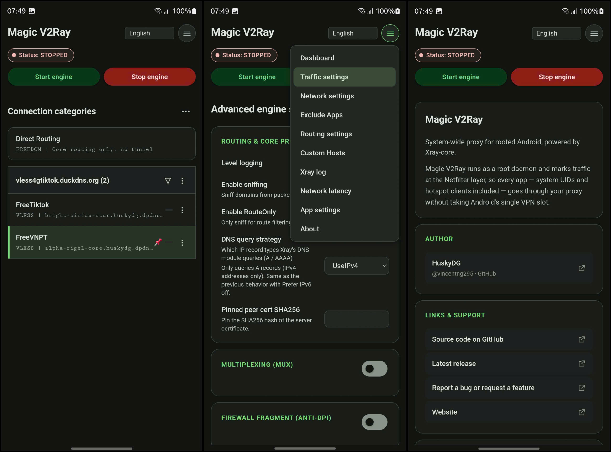

# Magic V2Ray

[English](../README.md) | [Tiếng Việt](../vi/README.md) | [Русский](./README.md) | [简体中文](../zh-CN/README.md) | [繁體中文（台灣）](../zh-TW/README.md) | [繁體中文（香港）](../zh-HK/README.md)



Мощный современный менеджер интернет-прокси для Android (поддерживаются устройства как **с root**, так и **без root**). Он направляет системный и прикладной трафик через высокопроизводительные прокси-ядра, чтобы защитить ваше соединение, обходить сетевые ограничения и делиться подключением с другими устройствами.

---

## Что такое Magic V2Ray?

**Magic V2Ray** — это продвинутый сетевой клиент для Android. Он выполнен как самостоятельное Android-приложение и содержит в себе все инструменты управления и прокси-ядра, обеспечивая стабильное сетевое подключение на всём устройстве.

Начиная с версии **v2.0**, в Magic V2Ray появился **режим Non-Root** на базе Android `VpnService`, который позволяет пользователям без root спокойно запускать прокси-движок. Пользователи с root по-прежнему получают маршрутизацию на уровне ядра через демон, постоянную работу в фоне и низкоуровневую маркировку пакетов.

В комплекте — лаконичный Web UI, в котором удобно организовывать прокси-конфигурации, управлять подписками и следить за сетью.

---

## Основные возможности и режимы работы

### 1. Режим Root (движок-демон)
Рассчитан на максимальную стабильность и расширенную маршрутизацию на устройствах с root (Magisk, KernelSU, APatch):
- **Неубиваемое соединение:** работает как системный демон с правами root. Android Low Memory Killer (LMK) не завершит процесс даже при сильной нехватке памяти.
- **Глубокий охват маршрутизации:** перехватывает трафик на уровне Netfilter, что позволяет прозрачно проксировать системные UID, до которых не дотягиваются обычные VPN.
- **Системный слот VPN не занимается:** работает без использования стандартного слота VPN Android — нет постоянного значка ключа в строке состояния и нет конфликтов с VPN для отдельных приложений.
- **Нативная раздача (Hotspot / Tethering):** перехватывает трафик в цепочке `PREROUTING` и автоматически направляет устройства, подключённые по Wi-Fi Hotspot или USB-модему, через прокси-туннель.
- **Динамическое переподключение:** напрямую слушает сетевые события ядра (`ip monitor`) для мгновенного переключения Wi-Fi ↔ мобильная сеть.

### 2. Режим Non-Root (VpnService)
Начиная с версии **v2.0**, устройства без root-доступа могут без проблем запускать Magic V2Ray через встроенный в Android движок `VpnService`:
- Безопасная стандартная маршрутизация прокси в пользовательском пространстве.
- Не требуются ни root, ни пользовательские модули ядра.

---

## Дополнительные возможности

- **Плитка быстрых настроек (Quick Settings Tile):** включайте и выключайте прокси-движок прямо из шторки уведомлений. Долгое нажатие на плитку открывает приложение.
- **Живое обновление модуля:** полностью поддерживается для версии 176 и новее — обновляйте службу «на лету», не перезагружая устройство.
- **Организация по категориям:** группируйте прокси-серверы в собственные папки и категории.
- **Умный импорт подписок:** просто вставляйте URL подписок, «сырые» конфигурации или смешанный текст с кодами.
- **Автообновление в один клик:** поддерживайте подписки в актуальном состоянии одним нажатием.
- **Раздача по хотспоту без root:** в режиме Non-Root Shizuku позволяет делиться прокси с клиентами хотспота / USB (Android 13+).
- **Раздача по хотспоту:** делитесь проксированным подключением с ноутбуками, консолями и другими телефонами через Wi-Fi Hotspot по IPv4/IPv6.
- **Сайты провайдеров:** добавьте сайт продавца VPN как категорию, откройте его во встроенном мини-браузере, нажмите кнопку «Синхронизация» для импорта узлов и закрепите ярлык на главном экране. См. [Deep Link](API.md#deep-link-для-провайдеров).

---

## Установка и использование

Magic V2Ray распространяется как самостоятельное Android-приложение (`.apk`), которое одновременно служит zip-архивом для прошивки как root-модуль.

> [!IMPORTANT]
> Файл `.zip`, скачанный с [modules.kernelsu.org](https://modules.kernelsu.org), — **это только установщик**, а не APK. Скачайте APK на [странице Releases репозитория](https://github.com/vincentng295/Magic_V2Ray/releases).

### Пользователи без root
1. Скачайте и установите `magic_v2ray-*-arm64-v8a.apk` (или `-x86_64.apk`).
2. Откройте приложение, выберите **Non-Root (VpnService) Mode**, предоставьте разрешение VPN и запустите подключение.

### Пользователи с root (Magisk / KernelSU / APatch)
**Вариант A: установка через менеджер root (модуль + приложение)**
1. Переименуйте `magic_v2ray-*.apk` в `magic_v2ray-*.zip`.
2. Прошейте файл в Magisk / KernelSU / APatch (Modules → Install from storage). Будет установлен фоновый модуль и выполнена команда `pm install` для интерфейса приложения.
3. Перезагрузите устройство или просто откройте приложение.

**Вариант B: обычная установка APK**
1. Установите `magic_v2ray-*-arm64-v8a.apk` и откройте его.
2. Предоставьте права root. Приложение автоматически проверит и настроит движок root-демона в `/data/adb/modules/magic_v2ray` (пользовательские настройки сохраняются в `/data/adb/magic_v2ray`).

*Примечание: кнопка **Action** модуля (Magisk 27+ / KernelSU / APatch) напрямую запускает приложение и при необходимости автоматически устанавливает `app.apk`, если его нет.*

---

## API и интеграция

Всё для сайтов, продавцов VPN и других приложений, интегрирующихся с Magic V2Ray (deep link, connect / disconnect, доступ к узлам, временные настройки), описано в [API.md](API.md):

- [Deep Link для провайдеров](API.md#deep-link-для-провайдеров)
- [Подключение из других приложений и сайтов](API.md#подключение-из-других-приложений-и-сайтов)
  - [События информации и состояния (API level 1)](API.md#события-информации-и-состояния-api-level-1)
  - [Узлы и специальные connect-uri (API level 2, только для приложений)](API.md#узлы-и-специальные-connect-uri-api-level-2-только-для-приложений)
  - [Использование из Termux (или любого shell)](API.md#использование-из-termux-или-любого-shell)
  - [Временные настройки (`overrides`)](API.md#временные-настройки-overrides)

---

## Сборка из исходного кода

```sh
./build.sh          # Выводит APK (arm64-v8a, x86_64, universal) -> dist/
                    # (Любой APK можно переименовать в .zip для использования как установщик модуля)

```

**Требования:**

* JDK 17+
* Gradle 8.7+ (рекомендуется 8.9)
* Android SDK (`ANDROID_HOME`, целевая платформа `android-35`)
* Android NDK (для нативных помощников)

Ресурсы Web UI находятся в `app/src/main/assets/webroot`. Приложение предоставляет `window.ksu`-совместимый мост (`exec`, `listPackages`, `getPackagesInfo`).

---

## Благодарности и авторство

* **[Xray-core](https://github.com/XTLS/Xray-core):** движок, отвечающий за протоколы прокси нового поколения (VLESS, VMess, Trojan и др.).
* **[xray-rust](https://github.com/aimalygin/xray-rust):** Мобильно-ориентированная реализация на Rust протоколов VLESS, REALITY, Vision, Trojan, Shadowsocks 2022, VMess AEAD, Hysteria 2, WireGuard, а также TUN, маршрутизации и DNS для встраиваемых прокси-клиентов. Встроена в приложение как дополнительное ядро `xray-rs`.
* **[curl-android](https://github.com/vvb2060/curl-android):** готовая утилита командной строки `curl` и статическая библиотека `libcurl` (prefab) для Android.

---

## Лицензия

Проект распространяется по лицензии **GNU General Public License v3.0 (GPL-3.0)**. Используя этот проект, вы соглашаетесь с условиями и положениями лицензии. Подробности см. в файле [LICENSE](../../LICENSE) в этом репозитории.

По сути, вы вправе свободно использовать, изменять и распространять это программное обеспечение при условии, что в своём проекте вы сохраните ту же лицензию и откроете исходный код. Кроме того, использование исходного кода или воспроизведение возможностей Magic V2Ray в программном обеспечении с закрытым исходным кодом может нарушать условия лицензии.
